# Native Gantt

The Gantt parser validates dates and resolves the complete schedule before
layout. Unsupported statements return an error so embedding applications can
retain source rather than display guessed dates. Rendering uses the existing
SVG backend and adds no dependency or runtime installation requirement.

## Supported syntax

- Titles, sections, task IDs and labels, including Unicode covered by the caller's fonts.
- `dateFormat YYYY-MM-DD` (also the default), with strict Gregorian dates in years 0001–9999.
  Clock formats `HH:mm`, `HH:mm:ss` and `HH:mm:ss.SSS` also work, either alone or
  after `YYYY-MM-DD` separated by a space or literal `T` (`[T]` is accepted too).
- Explicit start/end timestamps; `h`, `m`, `s` and `ms` durations, including
  fractions that resolve to whole milliseconds, such as `1.5h` and `0.125m`.
  Integral `d`, `w`, `M` and `y` durations also work. Months and
  years use calendar arithmetic and clamp to the last valid day of the month.
- Omitted starts continue from the preceding task's end, including across sections.
  The first task must have an explicit date or resolve through a dependency.
- `after ID` and `after ID1 ID2` use the latest dependency end. IDs are case
  sensitive; forward references work. Unknown IDs, duplicates and cycles fail.
- Independent `done`, `active`, `crit` and `milestone` tags, including combinations.
  Milestones appear at the interval midpoint; `0d` is an exact point.
- `excludes weekends` and explicit ISO holiday dates, separated by spaces or
  commas. Repeated `excludes` lines accumulate. Weekends are Saturday/Sunday.
- `axisFormat` with `%Y`, `%y`, `%m`, `%d`, `%e`, `%b`, `%H`, `%M`, `%S`, `%L`,
  `%%` and literal text. `%L` is three-digit milliseconds; date fields require dated input.
  Month abbreviations are English. Tick spacing adapts to label width.
- `todayMarker off`. The native renderer does not draw a current-date marker.
- The existing `displayMode: compact` front matter remains available to direct
  backend callers; consumers may reject front matter independently.

Timezones, AM/PM, other date formats, fractional calendar units (`d`/`w`/`M`/`y`),
fractional milliseconds, weekday exclusions, custom weekends, `includes`,
`until`, `tickInterval`, `weekday`, `inclusiveEndDates`,
`topAxis`, vertical markers, current-date styling and click handlers return an
error. Lowercase `m` means minutes; uppercase `M` means calendar months.
This is a bounded native subset, not full Mermaid.js compatibility.

Clock-only tasks start on anonymous day zero, without consulting today's date.
Durations and dependencies can cross midnight; the default axis adds `+1d`,
`+2d`, etc. when needed. An explicit clock end earlier than its start is rejected;
use a duration or a dated timestamp for an overnight task. Calendar exclusions,
month/year durations and date axis fields require dated input.

```mermaid
gantt
    dateFormat HH:mm
    axisFormat %H:%M
    Build :build, 09:00, 1.5h
    Check :after build, 15m
    Ship  :milestone, 0ms
```

## Schedule and limits

`src/gantt.rs` owns calendar calculations and iterative dependency resolution;
`src/gantt/time.rs` owns strict timestamp parsing, exact duration arithmetic and
axis ticks. Scheduling uses integer milliseconds and layout converts relative
offsets to pixels, preserving short intervals even near year 9999.
`src/parser/gantt.rs` owns syntax. Layout and SVG drawing
consume the validated dates; they do not substitute arbitrary durations or the
current date for invalid input. Programmatically constructed invalid graphs
produce an error layout.

Schedules allow at most 512 tasks, 4,096 explicit dependency references, 128
sections and 128 excluded-date entries. Each task and the complete chart span
at most 36,600 calendar days. Decimal durations accept at most nine fractional
digits and must resolve exactly to integer milliseconds. Axis formats are
limited to 128 bytes and generate at most five ticks. Consumers
can impose smaller source, task, label and raster limits.

Dependency resolution uses a queue, not recursion. Weekend counting uses whole
weeks; a binary search finds excluded-day endpoints without walking every day
of a long schedule. Holiday storage and scan work are bounded by the date limit.
There is no timezone lookup or access to the clock.

Exclusions follow Mermaid's endpoint semantics: duration-based tasks extend
their dependency end to an included day, while the visible bar omits trailing
excluded days. Explicit end dates remain exact. Excluded dates are not shaded
as separate chart columns in this version. For dated times, exclusions are
checked at whole-day offsets from the start time, matching the reference's
duration calculation; a short task crossing midnight is not automatically extended.

Reference behavior is documented in the [official syntax guide](https://mermaid.js.org/syntax/gantt.html)
and the upstream [Gantt date calculations](https://github.com/mermaid-js/mermaid/blob/develop/packages/mermaid/src/diagrams/gantt/ganttDb.js).
Tests check explicit expected dates, leap years and month ends, combined tags,
milestone positions, milliseconds, overnight tasks, invalid schedules and long chains. An independent small
day-by-day oracle checks the arithmetic calendar across weekend and holiday boundaries.

The Gantt IR now represents `GanttStatus` as independent boolean flags and adds
`GanttTask::end` plus graph calendar/axis fields, including `gantt_date_format`.
Layout's `time_start`, `time_end`, task `start` and `duration` now use `f64`;
their unit remains civil days, with fractions for sub-day values. Clock-only
values use anonymous day zero instead of a calendar origin. Callers constructing
Gantt structs directly must initialize these fields; the parse/render façade is unchanged.
